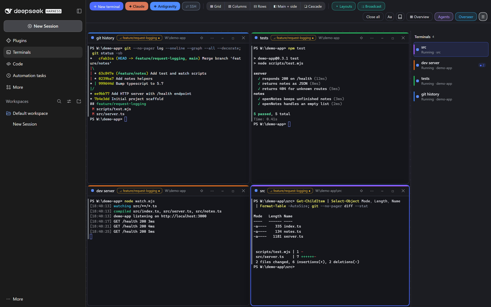
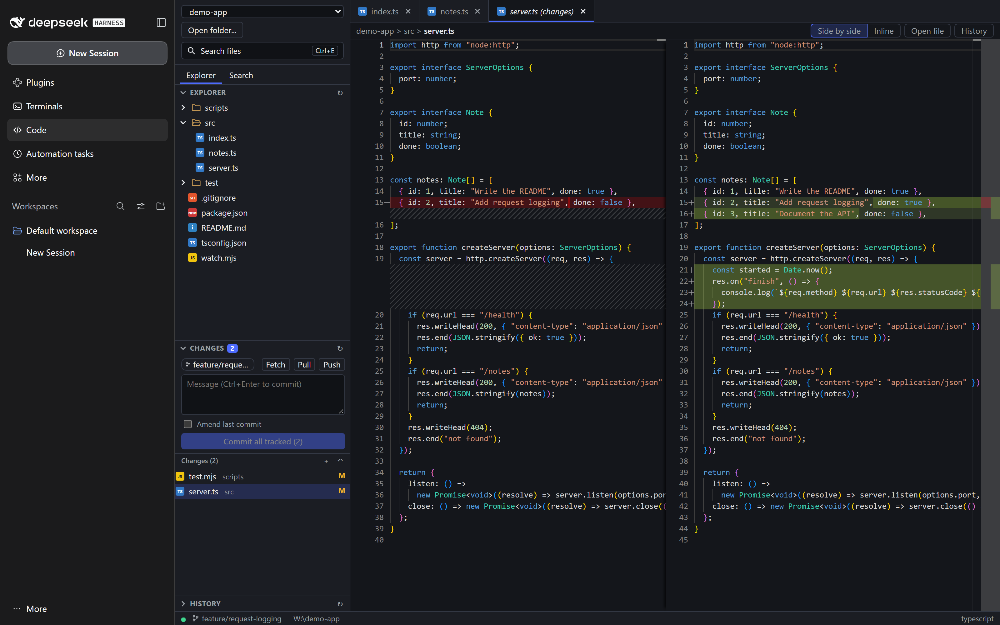

# DeepSeek Harness plugins

Terminals and a code editor for the DeepSeek Harness (DSH) desktop app, built for running several coding agents side by side and reviewing what they change.

[](https://github.com/Nikodem5/dsh-web-terminal/actions/workflows/ci.yml)
[](https://www.npmjs.com/package/@nikodem5/dsh-web-terminal)
[](https://www.npmjs.com/package/@nikodem5/dsh-code-editor)
[](LICENSE)
[](https://nodejs.org)



## What's in here

| Plugin | What it adds | Package README | npm |
|---|---|---|---|
| `@nikodem5/dsh-web-terminal` | **Terminals** page: a workspace of real terminals, with agent status for Claude Code and Antigravity CLI | [packages/terminal](packages/terminal/README.md) | [npm](https://www.npmjs.com/package/@nikodem5/dsh-web-terminal) |
| `@nikodem5/dsh-code-editor` | **Code** page: Monaco editor, git tools and markers for files an agent changed | [packages/code-editor](packages/code-editor/README.md) | [npm](https://www.npmjs.com/package/@nikodem5/dsh-code-editor) |

Both plugins run locally; the one feature that sends data out is the terminal's optional Overseer (see [How it works](#how-it-works)).

## Terminals (`dsh-web-terminal`)

- Free-form workspace of real PTY terminals: drag, resize, snap, pin; shells survive page reloads
- Attention and notifications: see which agent is working or needs you, badges, desktop notifications, optional chime
- Pattern alerts raise a terminal's attention badge when its output matches a text or regex pattern
- Overseer panel (Ctrl+Shift+O) answers read-only questions about your open terminals, using the model set in the app
- Stats bar with Claude subscription usage (5h and 7d windows, with a forecast)
- Sub-agents panel, mission control overview, help panel (F1)
- Command blocks via shell integration (PowerShell, bash): jump between commands, failed-command flags, sticky bar
- SSH terminals from `~/.ssh/config`, clickable file paths, send a selection to another terminal

## Code (`dsh-code-editor`)



- Monaco editor with tabs, diff editor, safe saving (detects changes on disk)
- Git tools: status, stage/unstage/discard, commit, amend, branches, fetch/pull/push, history, nested repositories
- Search in files, Markdown preview (sanitized), quick open
- "Changed by agent" markers for files a Claude session in a Terminals window edited
- Only folders you register can be read or written, and `.git` internals are off limits

## Install

### From npm

```powershell
dsh plugin --profile desktop add @nikodem5/dsh-web-terminal
dsh plugin --profile desktop add @nikodem5/dsh-code-editor
```

Use `--profile web` instead of `desktop` for the browser GUI. Restart DSH afterwards, since plugins load at startup.
Remove one with `dsh plugin --profile <profile> remove <name>`.

### From a release archive

1. Download `dsh-plugins-0.2.0.zip` from [GitHub Releases](https://github.com/Nikodem5/dsh-web-terminal/releases) and unzip it.
2. Close the app.
3. In the unzipped folder run `node install.mjs desktop` (or `web`; with no profile both are used). `--dry-run` previews.
4. Start the app.

To update, repeat with the newer archive. To remove: `node install.mjs --remove desktop`. Use
`--package @nikodem5/dsh-web-terminal` or `--package @nikodem5/dsh-code-editor` for just one plugin. `--package` also
accepts the short name (`dsh-web-terminal`) or the folder name.

### From source

```
git clone https://github.com/Nikodem5/dsh-web-terminal.git
cd dsh-web-terminal
npm install
npm run build
npm run install:desktop      # or install:web; restart the app afterwards
```

After that, the help panel (F1) → **Update from source** pulls, rebuilds and reinstalls with one button; **Restart app** next to it restarts the app.

`npm test` runs all tests; `npm run pack` builds the release archive `dsh-plugins-0.2.0.zip` into `dist/`. The installer copies each plugin
into `~/.dsh/profiles/<profile>/node_modules` (override the location with `DSH_HOME`), because linked packages outside
the profile tree do not get their browser half loaded.

### Upgrading from 0.1.0

Up to 0.1.0 the plugins were installed under the unscoped names `dsh-web-terminal` and `dsh-code-editor`. The archive and source installers replace that copy in 0.2.0; if you switch to the npm packages, first remove the old copy with the installer you used (`node install.mjs --remove --package dsh-web-terminal <profile>`, and the same for `dsh-code-editor`), or both copies are loaded.

## Requirements

- DeepSeek Harness 0.1.5 or newer (desktop app or `dsh web`): the sidebar entries and pages use the panel list added in
  that version, and older versions load the plugins without showing them. Developed and tested against 0.2.2-rc.1
- Node.js 22+ on PATH. The host runs `node` for the Claude status-line and hook helpers; without it the usage
  stats, the sub-agents panel and the "Idle" state of a fresh Claude terminal are unavailable (terminals and the other
  agent states still work). The installer needs Node as well
- Git, for the editor's git features
- Optional: Claude Code CLI and/or Antigravity CLI (`agy`), for the agent features (Antigravity reports status; usage and changed-file markers with its opt-in integration; no sub-agents)
- Windows is the primary platform, Linux is supported, macOS is untested

## How it works

Each plugin has a host half (a Node module mounted in the DSH server: PTY sessions, file and git routes, WebSockets)
and a client half (a bundle loaded into the app UI). Every route and socket accepts only loopback peers and Hosts and requires a per-boot token (see SECURITY.md).
No data leaves your machine, with two exceptions: what the agents you run in a terminal (Claude Code, Antigravity CLI)
send themselves, and the Overseer, which sends terminal content to the model provider configured in the app each time
you ask it a question (it says so before the first one).

## Security notes

- The tools assume a single-user machine: any local process can connect to the loopback servers.
- The editor reads and writes only inside folders you registered, refuses symlink escapes and `.git` internals, and
  never runs git through a shell.
- Terminals give a real shell with your privileges; that is their purpose.
- SSH uses your own `ssh` and `~/.ssh/config`; the plugin stores no passwords or keys.
- Markdown previews are sanitized and never load remote images.

## Documentation

- [Terminal plugin](packages/terminal/README.md)
- [Code editor plugin](packages/code-editor/README.md) and its [HTTP/WebSocket API](packages/code-editor/docs/API.md)
- [Shared helpers](packages/shared/README.md)
- [Changelog](CHANGELOG.md), [Contributing](CONTRIBUTING.md), [Security policy](SECURITY.md)

## License

[MIT](LICENSE), (c) 2026 Nikodem Marcinkiewicz
